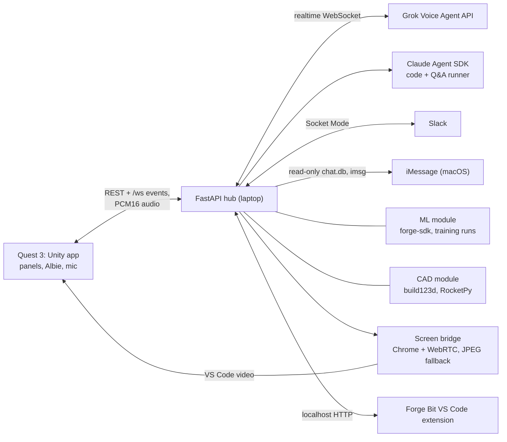

# Albie

Albie is a mixed reality workspace for engineers on Meta Quest 3 and 3S, led by an AI gator who knows every corner of it. Sit down at your real desk, and Albie hops up beside you, reads you your Slack digest, and unfolds your workspace. Then you just talk to him.

- Built at Gator Hack V (UF AI Days 2026) by a team of five. Unity 6 and the Meta XR SDK on the headset; a Python FastAPI hub on the laptop runs the voice (Grok), the deep work (Claude), and the ML, CAD and messaging modules.
- Demo video (3 min): https://youtu.be/tkZxQO4fzrE
- AI tools: we built Albie with Claude Code (Anthropic) and Codex (OpenAI) as coding assistants, as the MLH rules allow. At run time Albie uses the Grok Voice Agent API, the Claude Agent SDK and the Claude API. Details in [docs/DISCLOSURE.md](docs/DISCLOSURE.md).
- Run it: [docs/SETUP.md](docs/SETUP.md) (full guide, also for a coding agent) or [docs/DEV.md](docs/DEV.md) (short version). Third-party code, assets and AI tools: [docs/DISCLOSURE.md](docs/DISCLOSURE.md).

## What it does

- **Talk to him like a person.** No wake word. Pause mid-sentence and he waits; talk over him and he stops. Quick jobs (resize a fin, open a file) happen on the spot; deep work (read your repo, change code) goes to Claude while he keeps talking with you.
- **Code.** Your real VS Code streams into the headset over WebRTC, extensions and all. Albie catches your errors as they happen and offers a fix.
- **ML.** Point Albie at a repo, or say "pull up the pytorch cifar repo." He works out what you are training, wires it up, and streams the run live around you. Ask "what can I do better?" and he diagnoses the run, makes a change, and retrains. That took a CIFAR-10 model from **60.6% to 79.0%** accuracy.
- **CAD with real physics.** Say "make the fins smaller," and the build123d part rebuilds while the rocket's stability updates live. "How high will it go?" runs a RocketPy flight on a real Estes C6 thrust curve. A Unitree G1 humanoid walks on its real trained gait.
- **Neural Net Lab.** Poke a live network with your hands and watch the decision boundary move. When a spiral classifier got stuck at **52%**, Albie fixed it: **92%** in about 11 seconds, then on to nearly 100%.
- **Messages.** Albie reads your Slack and allowed iMessage chats and drafts replies. Nothing sends until you tap Send or say "send it".
- **The crew.** Albie leads 9 gator specialists (Scout, Builder, Fixer, Tester, Reviewer, Scribe, Shipper, Designer, Sentinel). Each is its own Claude agent in its own git worktree. Say "Tester, run the tests," and that gator gets to work.
- **The rest of your day.** A focus timer, a to-do list he keeps as you talk, and a movie on the big screen that skips to a scene when you describe it.

## How it works (short)

- **Voice:** the headset streams microphone audio to the hub, which holds one live session with Grok's realtime speech-to-speech API. Grok calls about 60 shared tools directly; anything slow is delegated to the Claude Agent SDK, and the hub tracks what the headset is still playing so interruptions land.
- **ML:** TypeSafe's Jev answers typed questions about the repo (model type, framework, training file) with a confidence score, so Albie asks you when it is unsure. Claude writes a small adapter, and `forge-sdk` streams the run to the headset.
- **CAD:** each design is a parametric build123d script. A voice edit sets numbers, the part regenerates, and the stability and flight numbers come from Barrowman math checked against RocketPy.
- **One hub:** one FastAPI process and one WebSocket (`/ws`) to the headset. Every Unity module also runs on mock data with the hub off.

## Architecture

- Unity is a view; the hub owns the state. All Unity networking goes through `ForgeNet` (one socket, `/ws`).
- The contracts (REST endpoints and `/ws` events) are in [docs/PROJECT_CONTEXT.md](docs/PROJECT_CONTEXT.md) section 7.
- Albie edits code in his own sandbox repo (`sandbox/setup.sh`), so voice edits never land in this repo.

## Tech stack

- Unity 6 (6000.6.7f1), URP, Meta XR All-in-One SDK 207 (Interaction SDK, MR Utility Kit), OpenXR, com.unity.webrtc, glTFast
- Python 3.11+: FastAPI, Claude Agent SDK, Anthropic SDK, slack-bolt, build123d, RocketPy, PyTorch (ML example and `forge-sdk`)
- Grok Voice Agent API (speech to speech), Node + Playwright + Chrome (screen bridge), a VS Code extension (`vscode-bit/`)
- Albie's body: the Quirky Series alligator (Unity Asset Store, paid). Its files are not in this repo because the Asset Store EULA forbids redistribution; we added the opening mouth, the talk clips and all his behavior

## Repo map

"Forge" was our working name. Code names keep it (`ForgeNet`, `ForgePanel`, `unity/Assets/_Forge/`, `forge-sdk`, the **Forge** menu in Unity).

| Folder | What |
|---|---|
| `unity/` | The Quest app. Modules in `unity/Assets/_Forge/` (Core, Screens, ML, CAD, Pet, Messages, Desk) |
| `hub/` | The FastAPI hub: `agent/` (Albie, voice), `ml/`, `cad/`, `messaging/`, `desk/`, `screens/` |
| `forge-sdk/` | The Python package a training script uses to stream its run to the hub |
| `ml-examples/cifar10/`, `ml-examples/text-classification/` | The CIFAR-10 and AG News examples the ML desk trains |
| `screen-bridge/`, `vscode-bit/` | VS Code on the headset, and the extension Albie drives |
| `sandbox/` | Builds Albie's sandbox repo |

## How to run

1. Clone the repo. Buy and import the Quirky Series alligator from the Unity Asset Store (not in git, see [docs/SETUP.md](docs/SETUP.md) step 9), then open `unity/` in Unity 6000.6.7f1 (Meta XR SDK is already set up).
2. Copy `hub/.env.example` to an env file and add your keys. Run `sh dev-setup.sh <env file>` (macOS).
3. Build the Quest APK from Unity (File > Build Profiles > Android) and install it on the headset over USB.
4. Run `sh run-demo.sh`. It starts the hub on port 8000, opens the ML project and wires the Quest with `adb reverse`.
5. With the hub off, every module still runs on mock data in the Unity editor (desktop mode: WASD and mouse).

Full steps and gotchas: [docs/SETUP.md](docs/SETUP.md).

Security note: the hub, the screen bridge and the agent runner have no authentication and listen on the local network. Run them only on a private network or hotspot you control.

## Team

Built at Gator Hack V (UF AI Days 2026) by:

| Name | Department / major |
|---|---|
| Dev Goswami | BS Software Engineering, WGU |
| Adrian Pascual | Computer Science, CISE, College of Engineering |
| Satyabrata Das | Artificial Intelligence Systems, Department of Engineering Education (EED) |
| Hudson Marr | Electrical Engineering, ECE |
| Nandani Rai | MS in Computer Science |

## License

MIT, see [LICENSE](LICENSE). Third-party code, models, fonts and data keep their own licenses (see [docs/DISCLOSURE.md](docs/DISCLOSURE.md)).
