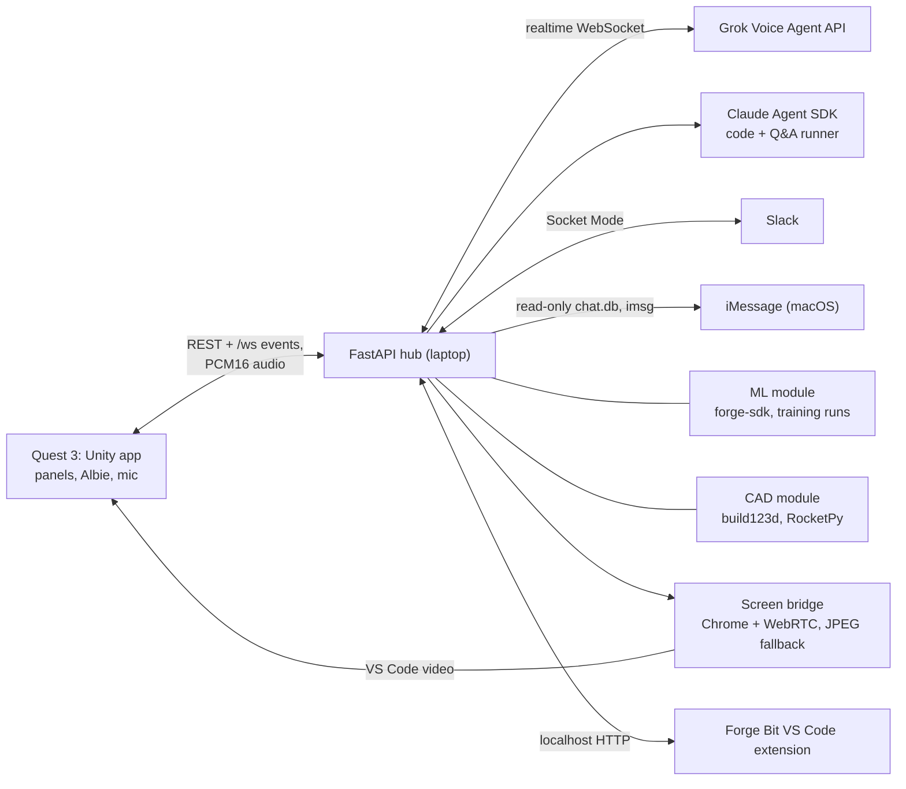

# Forge

- Forge is a mixed reality workspace for engineers on Meta Quest 3, built in Unity with the Meta XR SDK.
- You sit at your real desk. VS Code, your ML training run, your CAD part and your Slack inbox unfold around you as panels.
- Albie, an AI gator, sits on the desk. You talk to him: he edits code, trains and explains models, changes CAD parts, and drafts replies.
- A Python FastAPI hub on the laptop runs the voice (Grok), the coding agent (Claude), and the ML, CAD and messaging modules.
- Run it: [SETUP.md](SETUP.md) (full guide, also for a coding agent) or [DEV.md](DEV.md) (short version). Third-party code, assets and AI tools: [DISCLOSURE.md](DISCLOSURE.md).

## What it is

Meta's VR Glasses pitch "your laptop, but with more screens." We are building what comes after more screens: a desk that understands your engineering work.
An ML engineer sees their data, model and training run as objects they can grab and fix. A mechanical engineer changes a CAD part by talking.
Albie, an always-on agent, handles interruptions like Slack messages, so you stay in flow. One-liner: Jarvis for engineers.

## Demo flow

1. Sit at the desk. The Quest finds the table, Albie hops onto it and greets you, and the workspace unfolds with VS Code on the main screen.
2. ML mode: live training curves, a 3D model diagram, the dataset as a stack of photos, and a results wall of right and wrong predictions. Relabel or remove a bad sample. Ask "Albie, what can I do better?"
3. Neural Net Lab: a TensorFlow Playground style network on the desk. Albie offers a fix when training stalls.
4. CAD mode: a model rocket with live stability numbers. "Albie, make the fins smaller." The part rebuilds on the spot, and Fly runs a flight sim.
5. Messages: a Slack mention or an allowed iMessage comes in, and Albie reads it out. He drafts a reply. Nothing is sent until you tap Send or say "send it".
6. "Albie, stop" ends whatever he is doing and offers undo.

## Architecture

- Unity is a view; the hub owns the state. All Unity networking goes through `ForgeNet` (one socket, `/ws`).
- The contracts (REST endpoints and `/ws` events) are in [PROJECT_CONTEXT.md](PROJECT_CONTEXT.md) section 7.
- Albie edits code in his own sandbox repo (`sandbox/setup.sh`), so voice edits never land in this repo.

## Tech stack

- Unity 6 (6000.6.7f1), URP, Meta XR All-in-One SDK 207 (Interaction SDK, MR Utility Kit), OpenXR, com.unity.webrtc, glTFast
- Python 3.11+: FastAPI, Claude Agent SDK, Anthropic SDK, slack-bolt, build123d, RocketPy, PyTorch (ML example and `forge-sdk`)
- Grok Voice Agent API (speech to speech), Node + Playwright + Chrome (screen bridge), a VS Code extension (`vscode-bit/`)

## Repo map

| Folder | What |
|---|---|
| `unity/` | The Quest app. Modules in `unity/Assets/_Forge/` (Core, Screens, ML, CAD, Pet, Messages, Desk) |
| `hub/` | The FastAPI hub: `agent/` (Albie, voice), `ml/`, `cad/`, `messaging/`, `desk/`, `screens/` |
| `forge-sdk/` | The Python package a training script uses to stream its run to the hub |
| `ml-examples/cifar10/` | The CIFAR-10 example the ML desk trains |
| `screen-bridge/`, `vscode-bit/` | VS Code on the headset, and the extension Albie drives |
| `sandbox/` | Builds Albie's sandbox repo |

## Team

Built at Gator Hack V (UF AI Days 2026) by Dev Goswami, Hudson Marr, Adrian (apscual), Satyabrata (Satyabratadas) and Nandani Rai.
